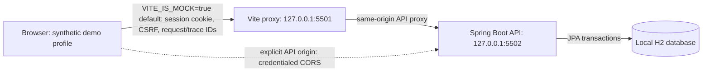

# Security Notes

## Scope and data flow

FinCore is a local portfolio simulator. With build-time `VITE_IS_MOCK=true` and no mock API
origin, the browser talks to Vite on loopback port `5501`, which proxies to Spring Boot on loopback
port `5502`; the local profile allows only the `127.0.0.1` and `localhost` frontend origins on that
port. `VITE_IS_MOCK` selects the API origin only; it does not switch financial data to browser
fixtures. Both modes fetch demo profiles and financial state from the API. If an explicit API
origin is configured, the browser connects directly and the API must allow the exact frontend
origin with credentialed CORS. The API persists synthetic records to local H2 by default. No
external bank, payment processor, analytics collector, or identity provider is connected.

## Assets and roles

- Synthetic account balances, ledger rows, beneficiaries, and transfer records.
- Session cookie and CSRF token used by the local demo browser.
- Customer can read only owned accounts and initiate transfers; cross-customer destinations require an active beneficiary.
- Operations and auditor profiles are read-only. Server-side checks remain authoritative; UI visibility is not an authorization control.

## Implemented controls

- Session fixation protection, `HttpOnly`/`SameSite=Lax` session cookie, CSRF validation on mutations, and explicit loopback frontend CORS origin.
- Profile listing and demo login are limited to the local/test Spring profiles. The profile list contains synthetic keys and roles read from the backend seed database; login resolves a submitted key server-side, and unknown keys are rejected.
- The build-time `VITE_IS_MOCK` switch selects an API origin; it has no `sessionStorage` override, does not create financial data, and does not authenticate users in the browser. Both modes load sign-in choices from `GET /api/v1/auth/demo-profiles`, establish sessions through the API, and retrieve account, balance, transfer, and ledger data from the backend. The frontend submits only the selected demo key; the backend resolves the user and role from its database.
- JSON DTOs are validated and unknown routes are denied.
- Account ownership is checked on reads and writes. Transfers lock involved records, validate available balance, post equal debit/credit ledger entries atomically, and bind idempotency keys to a request hash.
- Money is stored as integer minor units. Database constraints and service rules reject nonpositive amounts, negative balances, same-account transfers, and currency mismatches.
- Statement CSV export prefixes spreadsheet formula-like text while preserving numeric negative amounts; this prevents a saved beneficiary alias in a ledger description from being interpreted as a spreadsheet formula.
- Structured request logs include route template, method, status, duration, request ID, trace ID, and safe error codes. Request/response payloads, session cookies, authorization headers, and exception messages are not logged.
- Security headers include CSP, frame denial, content-type protection, and referrer policy.

## Residual risks and exclusions

- Demo profile selection is not identity verification. Demo profiles and login exist only in the local/test Spring profiles. Never publish this simulator as a real banking service or use real credentials, customer data, or balances.
- The default H2 file is not configured for encryption at rest. The local profile does not require HTTPS and uses a non-secure cookie because it binds to loopback.
- OIDC/MFA, account recovery, production-grade abuse controls, backups/restore, external penetration testing, dependency/SAST scans, and production observability integrations are not implemented or verified here.
- The Postgres profile is an integration option, not proof of hardened database roles, TLS, key management, or operational controls.
- Legal and regulatory obligations depend on product behavior, data, users, and jurisdictions. This prototype is not certified to any standard and its controls cannot guarantee legal compliance or prevent fines. Obtain qualified, jurisdiction-specific review before public deployment or handling real data/funds.

## Verification completed

Measurements from 2026-11-01:

- Frontend `npm run test:coverage`: 48 tests passed across 8 files. Full-source coverage is
  **95.50% statements, 90.17% branches, 94.05% functions, and 96.83% lines**. The aggregate 90%
  gate and the 95% per-file floors for `api.ts`, `config.ts`, and `format.ts` pass; no production
  module is excluded. Individual UI modules still have sub-90 categories: `App.tsx` (85.71%
  branches), `AppShell.tsx` (70% branches), `DashboardPage.tsx` (75% statements, 60% functions,
  80% lines), `InsightsPage.tsx` (80% branches, 85.71% functions), `SignInPage.tsx` (76.66%
  branches), `StatementsPage.tsx` (86.36% branches), and `content.tsx` (88.09% statements, 86.2%
  branches, 88.88% functions).
- Backend `mvn -B -Dspring.profiles.active=test verify`: 36 tests passed with in-memory H2.
  JaCoCo reports **99.07% instructions, 96.72% branches, 98.94% lines, and 98.09% methods**; the
  bundle-level 90% gate passes, with no application classes excluded. JaCoCo instructions are the
  bytecode-level statement proxy. The configured 95% instruction, branch, line, and method gates
  pass for `AccountService`, `TransferService`, `BeneficiaryService`, `DemoAuthService`,
  `DemoAuthController`, and `SecurityConfig`.
- Other backend class-level gaps remain and are not hidden by the aggregate gate: `ApiModels`
  (37.5% instructions, 33.3% lines, 50% methods), `FinCoreApplication` (37.5% instructions,
  33.3% lines, 50% methods), `DemoSeeder` (66.7% branches), `DemoUser` (85.71% methods), and
  `Beneficiary` (88.89% methods).

The committed Playwright data-mode test passed profile loading and an API-backed transfer 1/1 in
mock mode and 1/1 in live-selection mode, using isolated services and in-memory H2. This does not
prove production database or identity-provider connectivity. The broader role, denial, beneficiary,
and statement-export E2E matrix remains incomplete. The standalone frontend CI workflow does not
check out the separate backend repository, so it does not run this Playwright test. The latest
`npm audit --omit=dev` reported zero vulnerabilities. Checkstyle, Sonar, secret scanning, full
dependency/SAST review, the complete endpoint threat matrix, external security review, and
jurisdictional legal review remain open.
Passing tests and coverage are not a full OWASP ASVS assessment, penetration test, or security
certification.
