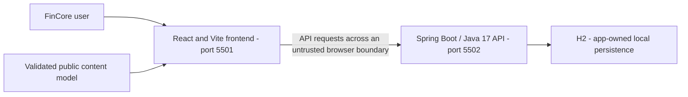
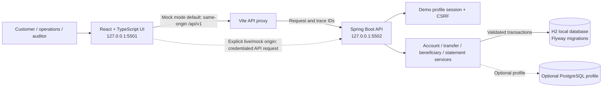
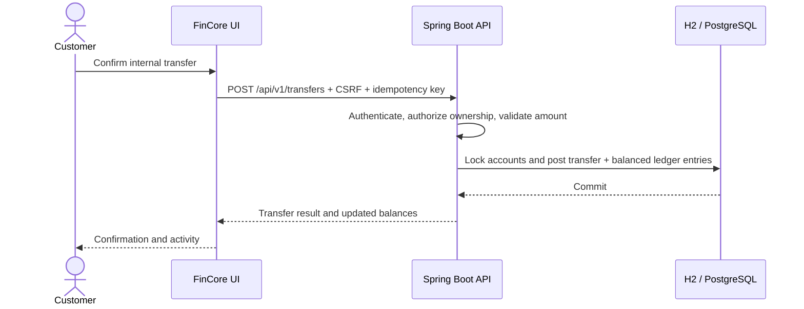
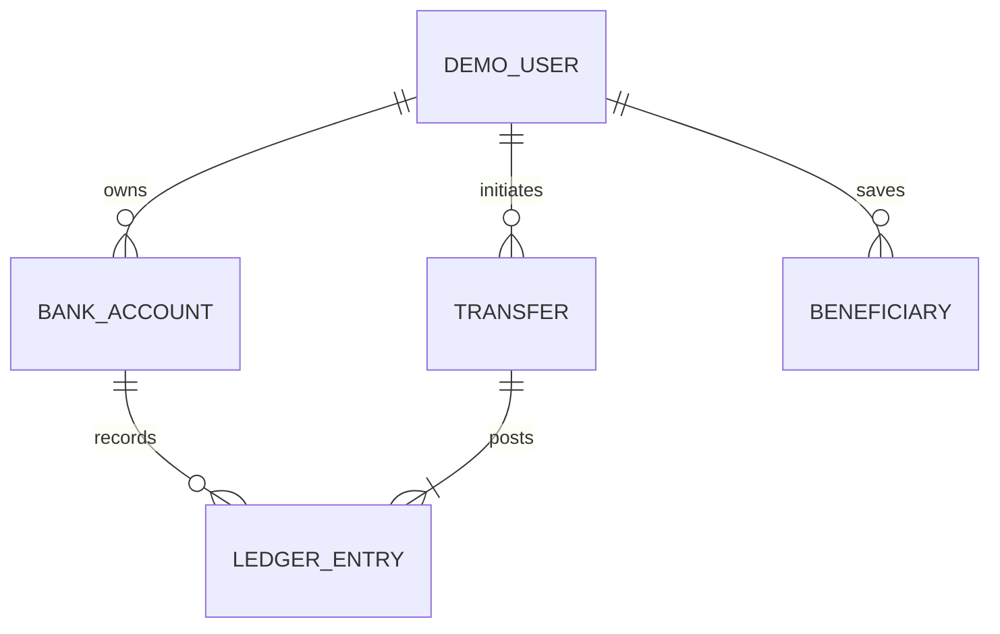

# FinCore Backend Architecture

Maintained in this independent Git repository at **docs/architecture.md**. Updated **2026-11-09**. The guide covers the implemented stack, interfaces, data model, operational limits, and release requirements.

## Contents

1. [Scope, users, and repository boundary](#1-scope-users-and-repository-boundary)
2. [Context, containers, and trust boundaries](#2-context-containers-and-trust-boundaries)
3. [Source ownership and module map](#3-source-ownership-and-module-map)
4. [Screens, navigation, and lifecycle](#4-screens-navigation-and-lifecycle)
5. [Primary workflows and recovery](#5-primary-workflows-and-recovery)
6. [Domain, persistence, and data ownership](#6-domain-persistence-and-data-ownership)
7. [API and internal contracts](#7-api-and-internal-contracts)
8. [Security, privacy, and egress](#8-security-privacy-and-egress)
9. [Design, accessibility, and platform adapters](#9-design-accessibility-and-platform-adapters)
10. [Build, checks, and deployment](#10-build-checks-and-deployment)
11. [Architecture decisions and tradeoffs](#11-architecture-decisions-and-tradeoffs)
12. [Requirements traceability](#12-requirements-traceability)
13. [Dated verification and limitations](#13-dated-verification-and-limitations)
14. [Extension rules and companion repository](#14-extension-rules-and-companion-repository)

## 1. Scope, users, and repository boundary

A banking workflow simulator for synthetic customers, operations staff, and auditors.

Accounts, internal ledger transfers, beneficiaries, statements, transaction search, and spending insights. Money remains integer minor units owned by the API.

This repository owns the Spring Boot / Java 17 API and H2 state. UI rendering belongs to the separate frontend. The service validates and executes the domain operations described below.

There are two independent Git roots for this application, each with its own README and architecture guide. A parent app/workspace folder is a checkout convenience. Use synthetic records; current local services remain on loopback.

### Scope and users

FinCore is a local banking simulator for synthetic customer profiles. Customer, operations, and auditor profiles view synthetic accounts and ledger activity. Customer profiles can create internal transfers and manage synthetic beneficiaries. No external bank, payment rail, or real funds are connected.

the relevant configuration or validation section in this guide
for environment configuration, isolated both-mode E2E commands, and the
future database/identity roadmap.

## 2. Context, containers, and trust boundaries

The API is the data authority, but only the identity/ownership controls actually implemented below can be relied on. CORS is not authentication.

### Context and containers

The browser is an untrusted presentation client. Build-time `VITE_IS_MOCK` defaults to `true` and selects the API origin; it does not switch user identity or provide data. In local development, mock mode uses the Vite proxy to `127.0.0.1:5502`. A deployed mock build requires `VITE_MOCK_API_BASE_URL`; live mode requires `VITE_REAL_API_BASE_URL`. Neither mode falls back to the other. The API authenticates a selected synthetic profile, applies role and account-ownership checks, validates request DTOs, and owns all persistence. Customer records are isolated server-side; operations and auditor profiles are read-only. The local profile binds to loopback. The optional PostgreSQL profile is not the default local database.

## 3. Source ownership and module map

| Owner/path                                                                                                                                                                                                                                                                                                                                                                                                                                                                        | Responsibility                                                               |
| --------------------------------------------------------------------------------------------------------------------------------------------------------------------------------------------------------------------------------------------------------------------------------------------------------------------------------------------------------------------------------------------------------------------------------------------------------------------------------- | ---------------------------------------------------------------------------- |
| [src/main/java/com/portfolio/fincore/FinCoreApplication.java](../src/main/java/com/portfolio/fincore/FinCoreApplication.java)                                                                                                                                                                                                                                                                                                                                                     | Spring Boot process entry                                                    |
| [src/main/java/com/portfolio/fincore/api/BankingController.java](../src/main/java/com/portfolio/fincore/api/BankingController.java) [src/main/java/com/portfolio/fincore/api/DemoAuthController.java](../src/main/java/com/portfolio/fincore/api/DemoAuthController.java) [src/main/java/com/portfolio/fincore/api/HealthController.java](../src/main/java/com/portfolio/fincore/api/HealthController.java)                                                                 | HTTP adapters and public request handling                                    |
| [src/main/java/com/portfolio/fincore/service/AccountService.java](../src/main/java/com/portfolio/fincore/service/AccountService.java) [src/main/java/com/portfolio/fincore/service/BeneficiaryService.java](../src/main/java/com/portfolio/fincore/service/BeneficiaryService.java) [src/main/java/com/portfolio/fincore/service/DemoAuthService.java](../src/main/java/com/portfolio/fincore/service/DemoAuthService.java)                                                 | Application/domain services; verify individual transaction/permission owners |
| [src/main/java/com/portfolio/fincore/repository/AuditEventRepository.java](../src/main/java/com/portfolio/fincore/repository/AuditEventRepository.java) [src/main/java/com/portfolio/fincore/repository/BankAccountRepository.java](../src/main/java/com/portfolio/fincore/repository/BankAccountRepository.java) [src/main/java/com/portfolio/fincore/repository/BeneficiaryRepository.java](../src/main/java/com/portfolio/fincore/repository/BeneficiaryRepository.java) | Persistence boundary and queries                                             |
| [src/main/java/com/portfolio/fincore/config/SecurityConfig.java](../src/main/java/com/portfolio/fincore/config/SecurityConfig.java)                                                                                                                                                                                                                                                                                                                                               | Security/session configuration and synthetic identity                        |
| [src/main/java/com/portfolio/fincore/api/ApiExceptionHandler.java](../src/main/java/com/portfolio/fincore/api/ApiExceptionHandler.java) [src/main/java/com/portfolio/fincore/config/RequestIdFilter.java](../src/main/java/com/portfolio/fincore/config/RequestIdFilter.java)                                                                                                                                                                                                  | Safe error handling and request logging                                      |
| [src/main/resources/db/migration/V1__fincore_schema.sql](../src/main/resources/db/migration/V1__fincore_schema.sql)                                                                                                                                                                                                                                                                                                                                                               | Ordered Flyway schema/seed migrations                                        |
| [src/main/resources/application-postgres.yml](../src/main/resources/application-postgres.yml) [src/main/resources/application.yml](../src/main/resources/application.yml)                                                                                                                                                                                                                                                                                                      | Local/postgres profile configuration                                         |
| [pom.xml](../pom.xml)                                                                                                                                                                                                                                                                                                                                                                                                                                                             | Java/dependency/build/quality gate authority                                 |
| [docs/openapi.yaml](../docs/openapi.yaml)                                                                                                                                                                                                                                                                                                                                                                                                                                         | Published request/response contract source                                   |
| [src/test](../src/test)                                                                                                                                                                                                                                                                                                                                                                                                                                                           | Existing test/support directory; configured does not mean rerun              |
| [.github/workflows](../.github/workflows)                                                                                                                                                                                                                                                                                                                                                                                                                                         | Configured CI; hosted outcomes require separate verification                 |

The source map follows the existing framework directories and test placement.

## 4. Screens, navigation, and lifecycle

This repository has no rendered screens. It supports the frontend through the HTTP/domain contracts in sections 5–7. Its lifecycle entry, response/error mapping, session behavior where present, and storage ownership are listed in section 3. Startup health is http://127.0.0.1:5502/health; that configured address is not evidence of a running service. Persistent state is owned by this backend; preserve existing database files during changes.

## 5. Primary workflows and recovery

### Primary workflows

#### Open a profile

Precondition: the frontend and selected API are available. Both modes load allowed synthetic profile keys and roles from `GET /api/v1/auth/demo-profiles`; the content model contributes presentation labels only. The client submits the selected key to `POST /api/v1/auth/demo-login`, and the local/test API resolves it against its seeded database before issuing a server-managed session. Unknown keys are rejected. `GET /api/v1/auth/me` restores an existing session; CSRF protects mutations and logout. The mode value cannot create identities, set roles, or change account, balance, transfer, or ledger ownership. Invalid or unavailable sessions return a safe error with a request ID. Demo profile login is not enabled as a production identity provider.

#### Create an internal transfer

Preconditions: an authenticated customer owns the source account, the destination is eligible, the amount is positive and within the server limit, and the request has an idempotency key. The API validates both accounts, checks currency and available balance, then atomically posts a debit and credit. Operations/auditor profiles and cross-customer account access are denied server-side. Duplicate keys replay the original result; insufficient funds, stale sessions, and validation failures leave balances unchanged. Safe audit and request events include correlation IDs, never raw credentials.

#### Manage beneficiaries

Precondition: an authenticated customer owns the session. The API lists that customer's beneficiaries and an allowlisted recipient directory, validates the selected destination and alias, and enforces ownership for add/remove operations. Operations and auditor users do not receive customer mutation rights. Duplicate or invalid destinations are rejected without changing account or ledger state.

#### Review statements and insights

Precondition: the user is authenticated and can access the requested account. The API derives statements and aggregates from the ledger. Unknown or another customer's account returns a safe 404. Invalid periods return a validated error; refreshing the view retries without changing ledger state. Statement exports use the validated API response rather than browser-created ledger records.

## 6. Domain, persistence, and data ownership

The API owns the current persistence boundary. Keep database engines, schema/migration order, exact-money rules where applicable, and transaction invariants consistent with executable source.

### Data ownership

The API owns `DemoUser`, `BankAccount`, `LedgerEntry`, `Transfer`, `Beneficiary`, and audit records. Amounts are integer minor units with an explicit currency. A transfer updates both account balances and writes matching debit/credit ledger entries in one transaction. Flyway owns schema changes. The frontend receives allowlisted DTOs and never determines balances, permissions, or transfer state.

## 7. API and internal contracts

The repository contract is [docs/openapi.yaml](../docs/openapi.yaml). Keep public paths, status/error envelopes, headers, payload validation, and compatibility tied to that source.

### API and authorization

All business endpoints are under `/api/v1`; `/health` is public and reports process health.

| Endpoint group                                                        | Access rule                                                               |
| --------------------------------------------------------------------- | ------------------------------------------------------------------------- |
| `/auth/demo-profiles`, `/auth/demo-login`, `/auth/me`, `/auth/logout` | Local demo session; CSRF on state changes                                 |
| `/overview`, `/accounts`, `/accounts/{id}/transactions`               | Authenticated; customer account ownership enforced                        |
| `/transfers`                                                          | Authenticated; customer role required to create; idempotency key required |
| `/beneficiaries` and `/beneficiaries/directory`                       | Authenticated; owner-scoped writes and reads                              |
| `/statements`, `/insights`                                            | Authenticated; account ownership enforced                                 |

## 8. Security, privacy, and egress

Current release limitation: **No bank connection or real funds. Model-failure recovery, a role-error translation, real identity, hosted database recovery, and deployment remain open.**

Only the local simulator controls in the current source are implemented. CORS, a role label, and mode selection do not provide a new production identity boundary.

Keep private credentials out of public models, browser bundles, logs, URLs, and source archives. No additional runtime network destination or external service is configured. Keep logs limited to the source-defined request/trace and safe aggregate fields. Backups, retention, deletion, and real-user ownership need explicit product/operations decisions before external exposure.

## 9. Design, accessibility, and platform adapters

There is no visual rendering or native package in this API repository. Preserve safe errors and stable contracts so the frontend can present accessible recovery states. Hardware scanning, banking/payment rails, shipping providers, and native integrations remain limited to what the current source actually implements; simulator behavior is not device/provider integration.

## 10. Build, checks, and deployment

Use Java **17** and Maven **3.9.16** with [pom.xml](../pom.xml). `mvn.cmd -B -ntp -Dspring.profiles.active=test verify` uses the configured isolated test profile. Run local startup through the existing README command; inherited DEBUG must be removed only in newly launched Java processes. Java verification was not rerun for the documentation updates. Maven dependency installation needs registry access.

The API remains loopback-only. Direct-start storage is `.local/fincore` relative to this repository.

CI configuration is listed in section 3. Run the configured checks before merging or releasing. Deployment requires separate verification of the selected hosting environment.

## 11. Architecture decisions and tradeoffs

### Design and failure-handling patterns

- **Layered backend:** REST controllers validate/map DTOs, services own business rules and transaction boundaries, repositories own persistence, and Spring Security owns session/role enforcement. The React UI calls one runtime-validated API client; presentation labels come from the strict content model.
- **Atomic ledger command:** a transfer validates ownership, role, amount, balance and destination before posting paired debit/credit entries and updating balances within one database transaction.
- **Idempotent commands:** transfer requests require an idempotency key. A same-key retry replays the prior result; a conflicting request does not post another transfer.
- **Explicit data modes:** the mode switch selects only the API origin. Both modes follow the same profile/session and API data contract; local E2E uses a separate in-memory H2 database and unreachable unselected endpoints.
- **Safe failure:** API unavailability and non-401 session failures are surfaced using model error copy; unauthorized requests do not receive a browser-generated user. Failed transfers leave balances and ledger rows unchanged.

The two Git repositories remain separate. Each owns one maintained README and this repository-local architecture guide. Shared application behavior may be described here for contract context, but implementation changes belong to the owning source module.

## 12. Requirements traceability

| Capability                       | Acceptance                                                        | Owner/path                                                               | Current status                                                | Evidence                               | Risk                                                                                                                                                     |
| -------------------------------- | ----------------------------------------------------------------- | ------------------------------------------------------------------------ | ------------------------------------------------------------- | -------------------------------------- | -------------------------------------------------------------------------------------------------------------------------------------------------------- |
| Repository-local architecture    | Guide available in this checkout and linked from README           | docs/architecture.md; README.md                                          | Documented and validated                                      | File, link, and diagram checks         | Keep documentation consistent with source changes                                                                                                        |
| API composition and domain state | Preserve existing workflows and failure states                    | src/main/java/com/portfolio/fincore/api/ApiException.java and source map | Implemented; application verification limits are listed below | Current source and existing app design | No bank connection or real funds. Model-failure recovery, a role-error translation, real identity, hosted database recovery, and deployment remain open. |
| Public deployment                | Verified identity, data durability, recovery, and hosted behavior | Existing deployment/API boundaries                                       | Needs separate hardening/verification                         | No new hosted evidence                 | Local checks do not establish production readiness                                                                                                       |

## 13. Dated verification and limitations

Last documentation review: **2026-11-09**. The checks below distinguish documentation validation from application and deployment testing.

- Repository-local guide, README link, source-path references, section/contents anchors, and Mermaid syntax: passed documentation validation.
- New application tests/builds, coverage, dependency audits, browser/device accessibility/performance, hosted CI, and Vercel deployment: **not rerun for the documentation updates**.
- Frontend production builds passed on 2026-11-09 with Node 24.15.0. Build success does not establish that all application quality gates pass.
- Outstanding baseline limit: No bank connection or real funds. Model-failure recovery, a role-error translation, real identity, hosted database recovery, and deployment remain open.

The baseline results below record earlier validation. Re-run the listed commands against the current revision before release.

Previously recorded application verification:

### Verification status

The local verification completed on 2026-11-01 using synthetic data and isolated test services.
The frontend passed 48 unit tests across 8 files with **95.50% statements, 90.17% branches, 94.05%
functions, and 96.83% lines**. Its API client, mode configuration, and formatting modules have
separate 95% coverage floors. The backend passed 36 tests with in-memory H2 and reports **99.07%
JaCoCo instructions, 96.72% branches, 98.94% lines, and 98.09% methods**. The backend also enforces
95% class-level gates for account, transfer, beneficiary, demo-auth, and security logic.

The Playwright profile-loading and API-backed transfer workflow passed once in each API mode. It
uses isolated local services and in-memory H2; this validates mode selection and the synthetic API
contract, not production PostgreSQL, identity, or payment integrations. Individual modules outside
the critical gates still have documented coverage gaps; see the frontend and backend quality
status documents. The standalone frontend CI workflow does not check out the separate backend
repository and therefore does not run this Playwright E2E test.

## 14. Extension rules and companion repository

Start with [README.md](../README.md) and this guide. The companion repository is [fincore-frontend](https://github.com/gopichand-retail-apps/fincore-frontend); clone the pair as siblings when using the existing local integration/model contract. This guide is inside the current repository and does not depend on a parent-folder architecture file to exist.

Update this guide when owned source, routes, persistence, identity, UI states, egress, or deployment behavior changes. Coordinate public contract changes with the companion repository and tests. Preserve existing data, run isolated checks with synthetic records, record failures, and review release and infrastructure changes before publication.
